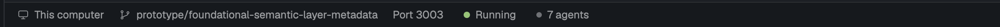

# herdr-metabase-dev

A [Herdr](https://herdr.dev) layout for Metabase development. The status bar
shows the current worktree's backend port (click it to open the app) and a
start/stop control for `ee` (`bun dev-ee`). The Spaces list shows each
space's repo and branch on a second line under its name.



See [RECIPE.md](RECIPE.md) for exactly what it does.

## Install

**With an agent:** in Herdr, ask your agent to "add the Herdr layout from
github.com/mazameli/herdr-metabase-dev".

**By hand:**

```sh
git clone https://github.com/mazameli/herdr-metabase-dev
cp herdr-metabase-dev/layouts/metabase-dev.json ~/.config/herdr-app/layouts/
cp -R herdr-metabase-dev/mods/metabase-status herdr-metabase-dev/mods/metabase-spaces ~/.config/herdr-app/mods/
herdr-app check ~/.config/herdr-app/mods/metabase-status
herdr-app check ~/.config/herdr-app/mods/metabase-spaces
herdr-app do layout.switch '{"name":"metabase-dev"}'
```

`ctrl-shift-l` switches back to your previous layout.

## Prerequisites

- [direnv](https://direnv.net), hooked into your shell.
- zsh, with the `ee` alias in `~/.zshrc`:
  ```sh
  alias ee='bun dev-ee'
  ```
- Per-worktree ports, so each worktree's Metabase can run side by side:
  1. Copy the port script onto your PATH:
     ```sh
     cp herdr-metabase-dev/bin/mb-ports ~/.local/bin/
     ```
  2. Add these lines to each worktree's `.envrc`, then run `direnv allow`:
     ```sh
     dotenv
     eval "$(~/.local/bin/mb-ports)"
     ```

  Your main checkout gets 3000/8080. Set `MB_MAIN_CHECKOUT` if it isn't at
  `~/workspace/metabase`. Every other worktree gets its own stable slot
  (3001/8081, 3002/8082, ...).

## Logs

`ee` runs in a background herdr-core terminal named `ee-<port>`. Read its
output with `hc read ee-3007`, or attach to it with `hc attach ee-3007`.
