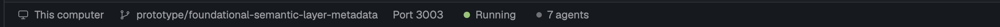

# Metabase Dev

Herdr's default window, with a status bar for Metabase development. When the
shown space is a Metabase worktree, the bar shows that worktree's backend port
(click it to open the app in a browser) and a start/stop control for the
`ee` dev command (`bun dev-ee`), with a red/yellow/green light. In the
Spaces list, each space's repo and branch sit on a second line under its name.
A Prompts panel on the right lists every prompt you sent the current agent;
click one to scroll that agent's terminal back to it.



## What you see

The window is the shipped `main` layout (spaces and agents sidebar on the
left, tab pills on top, panes as cards, Files/Changes panel on the right),
with three changes: the Spaces list, a Prompts panel on the right, and the
28px status bar along the bottom of the work column.

**The Prompts panel** is a 340px block (drag 240–700) at the right end of the
`work-body` row, after the Files/Changes panel. It's a card like Files: 10px
corners, `background` fill, 1px `border`.

- Its 42px header has "Prompts" (semibold), the count in `dim`, the agent's
  "space / tab" right-aligned in `dim`, and a 24px ✕ button that hides the panel.
- Below the header, the prompts run oldest to newest, each a card with 8px
  corners, `surface` fill and a 1px `border`, with 8px between cards:
  - "#N" on the left and the time on the right (10.5px, `dim`)
  - the prompt's text below (12.5px, `foreground`), cut off past 96px
- The list starts scrolled to the newest prompt at the bottom.
- A card turns `hover` under the pointer. The last one clicked stays
  `selected`, with an `accent` border.
- When there's nothing to list, a note says why: no agent focused, an agent
  on another machine, still reading, no prompts yet, or no transcript found.

**The Spaces list** is the shipped one, except for each space's row:

- Line one has the 18px colored letter mark (or the branch icon for a
  worktree nested under its repo), then the name. The name is 13px
  `foreground` and fills the rest of the row, truncated only at the edge.
- Line two has the repo and branch ("metabase · prototype/text-chart-type")
  at 11.5px in `dim`, then ahead/behind counts (↑2 in `ansi2`, ↓1 in `ansi1`).
  It starts under the name: 27px in, or 44px for a nested worktree.
- The shipped rules still decide what's on line two. `main` and `master` are
  left out, and so is a repo or branch that matches the space's name. When
  nothing is left, there's no second line.
- A row is 44px with two lines, and as shipped (30px, or 28px nested) with one.

The status bar is `chrome` colored with a 1px `border` top line. Its text is
11.8px in `muted`, with 16px gaps between items and 14px side padding. From
left to right:

1. The machine: a monitor icon and "This computer", or a server icon and the machine's name.
2. The branch: a branch icon and the shown space's git branch (only when there is one).
   It turns `foreground` on hover.
3. **Port**: "Port 3007", meaning the `MB_JETTY_PORT` that direnv sets in this
   worktree. It's `muted` like the branch and turns `foreground` on hover.
   It's hidden when the variable isn't set there.
4. **Dev control**: shown only next to a Port, and only for spaces on this computer.
   It has a 7px round light, then a label:
   - red (`ansi1`) "Not running"
   - yellow (`ansi3`), pulsing opacity 0.35→1 every 1 s, "Starting…"
   - green (`ansi2`) "Running"
   - yellow, pulsing, "Stopping…"

   It has 6px horizontal padding and 4px corners. On hover it gets a `hover`
   background and `foreground` text, except while stopping.
5. The agents: a 6px `dim` dot and "N agents", plus "· N needs you" in `blocked` when agents are blocked.
6. Then a spacer, "Prompts" (turns `foreground` on hover; toggles the
   Prompts panel), and the palette hint on the right ("⌘⇧P  commands" from
   the real binding) in `dim`.

## How it behaves

- **The folder** is the focused terminal's live folder when that terminal is in
  the shown space, else the space's folder.
- **The port** is read with `direnv exec <folder> sh -c 'echo "$MB_JETTY_PORT ${MB_FRONTEND_DEV_PORT:-8080}"'`
  (falling back to `/opt/homebrew/bin/direnv` when `direnv` isn't on PATH).
  It's cached per folder, read again every 15 s, and read when the folder changes.
  An `.envrc` that hasn't been allowed gives no port, so nothing is shown.
- **Clicking the branch** copies its name to the clipboard (`cx.write_to_clipboard`)
  and shows an info toast, "Copied branch name", for 2 s.
- **Clicking Port** runs `open http://localhost:<port>/`.
- **Status checks** run every 2 s while starting or stopping, and every 6 s otherwise:
  - the background terminal is found with `hc ls --json --label mbdev=<folder>`
  - the backend is checked with `curl --max-time 2 http://localhost:<port>/api/health`
  - the frontend dev server is checked with `curl` on `<frontend port>/`; any HTTP answer counts as up

  The state is decided like this:
  - **Stopping** after a stop click, until there is no terminal and the backend doesn't answer.
  - **Running** when the health check returns 200 and the frontend is up.
    If `ee` was started outside Herdr (no labelled terminal), a 200 alone is enough.
  - **Starting** when the terminal exists or the backend answers anything else (such as 503 while it initializes).
  - **Not running** otherwise.
- **Clicking while Not running** starts the command at once and shows Starting…:
  `hc run --bg --no-parent --rm --name ee-<port> --cwd <folder> --label mbdev=<folder> -- zsh -lic '<script>'`.
  The script loads direnv (`eval "$(direnv export zsh)"`) and mise
  (`mise hook-env -s zsh`, when installed), then runs `ee`. If `hc run` fails,
  the control goes back to Not running and an error toast appears.
- **Clicking while Starting or Running** shows Stopping… and stops it:
  - Started from Herdr: `hc kill <terminal>`. That hangs up the whole process
    tree, then escalates, so the backend, frontend build, cljs and static-viz all stop.
  - Started elsewhere: `kill` on the pids from `lsof -ti tcp:<port> -sTCP:LISTEN`,
    which stops only the backend.
- **Clicking while Stopping** does nothing.
- **Which agent the Prompts panel shows:** the agent in the focused pane;
  else an agent in the focused tab; else the last one it showed. It reads
  the transcript again every 3 s (and does nothing when its size hasn't changed).
  When the count grows, it scrolls to the newest.
- **Clicking a prompt** asks `prompts.py locate` how many lines up it is.
  Then it runs `terminal.scroll {terminal, to: "bottom"}` and
  `terminal.scroll {terminal, lines: -n}`, which puts the prompt's first line
  one row below the top of the view. If the prompt can't be found, a warning
  toast says why.
- **Toggling the Prompts panel:** `⌘⇧H` (`layout.toggle:prompts`, in
  `keys.json`) or the status bar's "Prompts". The ✕ runs `layout.hide {id: "prompts"}`.
- **Logs:** the background terminal isn't shown in any pane. Read it with
  `hc read ee-<port>`, or attach to it with `hc attach ee-<port>`.

## Built from

- `layouts/metabase-dev.json` is a clone of the shipped `main` (0.1.13). Its
  `status` block's `content.mod` is `metabase-status`, and its `spaces` block's
  is `metabase-spaces`; everything else is as shipped.
- `mods/metabase-spaces` is a clone of the shipped `spaces` (0.1.15). Its
  `row()` is a `v_flex` of the first line plus `gitTail(...)` as a second
  line. `gitTail` returns null when there's nothing to show, and
  `rowHeight` takes `two` for the 44px rows.
- `mods/metabase-prompts` (`place: none`) is the Prompts panel. Its list
  scrolls with a `ScrollHandle` (`scroll_to_item(last)`). It calls
  `python3 mods/metabase-prompts/prompts.py` through `exec`:
  - `list <terminal> [<file>:<size>]` returns
    `{agent, size, prompts: [{text, ts}]}`, or `{unchanged: true}`.
  - `locate <terminal> <index>` returns `{lines_up}` or `{error}`.

  The script finds the transcript from `hc get <terminal> --json`'s
  `foreground.pid`:
  - Claude Code: `~/.claude/sessions/<pid>.json` gives `sessionId`, which
    gives `~/.claude/projects/*/<sessionId>.jsonl`. It keeps `type: "user"`
    lines whose `origin.kind` is `"human"` and that aren't `isMeta`, and
    strips `<command-*>`, `<local-command-*>` and `<system-reminder>` tags.
  - omp: `ps -o tty= -p <pid>` gives the tty, and the second line of
    `~/.omp/agent/terminal-sessions/<tty>` is the session's `.jsonl`. It keeps
    `type: "message"` lines whose `message.role` is `"user"` and whose
    `attribution` is `"user"`.

  To locate a prompt, it reads `hc read <terminal> --json --lines 1000000`.
  It matches the first 40 characters of each prompt's first line (whitespace
  collapsed) against the scrollback rows, from the newest prompt back, each
  match above the last. Claude Code rows must start with `❯ `. omp draws a
  pasted `[Image #1, WxH]` as `📷 #1`, so both are stripped before comparing.
  Then `lines_up = rows_total - terminal_rows - row + 1`.
- `mods/metabase-status` (`place: none`) is a clone of the shipped
  `workspace-status`, with the Port and dev control added after the branch,
  and the Prompts toggle before the palette hint.
  It reuses `mods/workspace-chrome/{monitor,server,branch}.svg`.
- `herdr` functions it uses:
  - `spaces`, `agents`, `focused`, `theme`, `keys`, `window`
  - `exec` (for `direnv`, `curl`, `open`, `lsof`, `kill`)
  - `hc` (`ls`, `run`, `kill`)
  - `notify`, `run("app.palette")`
- It needs these on your machine:
  - direnv
  - zsh, with an `ee` alias (`alias ee='bun dev-ee'`)
  - `curl`, `lsof`, macOS `open`
  - and, for per-worktree ports, `bin/mb-ports` plus each worktree's `.envrc`:
    ```sh
    dotenv
    eval "$(~/.local/bin/mb-ports)"
    ```
    `mb-ports` gives the main checkout (`$MB_MAIN_CHECKOUT`, default
    `~/workspace/metabase`) slot 0 and every other worktree the lowest free
    slot from 1 up, remembered in `~/.config/mb-ports`. It exports
    `MB_PORT_SLOT`, `MB_JETTY_PORT=3000+slot`, `MB_FRONTEND_DEV_PORT=8080+slot`
    and `NREPL_PORT=50605+slot`.

## Watch out

- The background terminal's environment is herdr-core's, not your shell's.
  Running `ee` there needs a login and interactive zsh (for PATH and the
  alias), plus explicit direnv and mise exports, because their prompt hooks never run under `-c`.
- `fetch` has no timeout, so the checks use `curl --max-time 2` instead; a backend that's still starting can hang.
- Don't start `cx.spawn` work from `render` for folders that are already cached.
  Only a folder with no cached port starts a lookup.
- Spaces on other machines show neither the Port nor the control; the dev control only works locally.
- Claude Code in fullscreen mode (`"tui": "fullscreen"` in
  `~/.claude/settings.json`) keeps no terminal scrollback, so its prompts list
  but can't be jumped to; the toast says so. omp and Claude Code's default
  mode keep scrollback.
- Matching is by text, so a reply that quotes the start of a prompt word for
  word can catch the jump instead. Prompts that have left the scrollback
  can't be jumped to.
- `terminal.scroll` scrolls Herdr's view, not the program; it needs the core's
  history, which `hc read --lines` returns as rows exactly as drawn (wrapped).
- Because the layout and the mods are clones, they don't pick up Herdr's
  later changes to `main`, `spaces` or `workspace-status`.

## Done when

- In a worktree whose `.envrc` is allowed, the bar shows "Port <MB_JETTY_PORT>".
  In `~` it shows no Port and no control.
- Clicking the branch puts its name on the clipboard (`pbpaste` prints it).
- Clicking Port opens `http://localhost:<port>/` in the default browser.
- In a worktree with nothing running, clicking "Not running" creates a live
  terminal `ee-<port>` (`hc ls --label mbdev=<folder>`). The light turns
  yellow and pulses ("Starting…"), then turns green ("Running") once
  `/api/health` returns 200 and the frontend port answers.
- Clicking "Running" shows "Stopping…", the terminal disappears, nothing
  listens on the port any more (`lsof -ti tcp:<port>` is empty), and the control
  reads "Not running".
- In the Spaces list, a worktree space shows its name on one line and
  "metabase · <branch>" under it; a space in `~` stays one line.
- With an omp agent focused, the Prompts panel lists the same prompts as its
  session file, newest at the bottom. Clicking one scrolls the terminal so
  that prompt's first line is one row below the top of the view.
- `⌘⇧H` and the status bar's "Prompts" toggle the panel; ✕ hides it.
- `herdr-app check` passes for `mods/metabase-status`, `mods/metabase-spaces`
  and `mods/metabase-prompts`.
