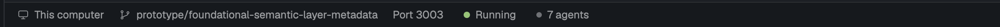

# Metabase Dev

Herdr's default window, with a status bar for Metabase development. When the
shown space is a Metabase worktree, the bar shows that worktree's backend port
(click it to open the app in a browser) and a start/stop control for the
`ee` dev command (`bun dev-ee`), with a red/yellow/green light. In the
Spaces list, each space's repo and branch sit on a second line under its name.



## What you see

The window is the shipped `main` layout (spaces and agents sidebar on the
left, tab pills on top, panes as cards, Files/Changes panel on the right),
with two changes: the Spaces list and the 28px status bar along the bottom
of the work column.

**The Spaces list** is the shipped one, except for each space's row:

- Line one has the 18px colored letter mark (or the branch icon for a
  worktree nested under its repo), then the name. The name is 13px
  `foreground` and fills the rest of the row, truncated only at the edge.
- Line two has the repo and branch ("metabase · prototype/text-chart-type")
  at 11.5px in `dim`, then ahead/behind counts (↑2 in `ansi2`, ↓1 in `ansi1`).
  It starts under the name: 27px in, or 44px for a nested worktree.
- The shipped rules still decide what's on line two. `main` and `master` are
  left out, and so is a repo or branch that matches the space's name. When
  nothing is left, there's no second line.
- A row is 44px with two lines, and as shipped (30px, or 28px nested) with one.

The status bar is `chrome` colored with a 1px `border` top line. Its text is
11.8px in `muted`, with 16px gaps between items and 14px side padding. From
left to right:

1. The machine: a monitor icon and "This computer", or a server icon and the machine's name.
2. The branch: a branch icon and the shown space's git branch (only when there is one).
   It turns `foreground` on hover.
3. **Port**: "Port 3007", meaning the `MB_JETTY_PORT` that direnv sets in this
   worktree. It's `muted` like the branch and turns `foreground` on hover.
   It's hidden when the variable isn't set there.
4. **Dev control**: shown only next to a Port, and only for spaces on this computer.
   It has a 7px round light, then a label:
   - red (`ansi1`) "Not running"
   - yellow (`ansi3`), pulsing opacity 0.35→1 every 1 s, "Starting…"
   - green (`ansi2`) "Running"
   - yellow, pulsing, "Stopping…"

   It has 6px horizontal padding and 4px corners. On hover it gets a `hover`
   background and `foreground` text, except while stopping.
5. The agents: a 6px `dim` dot and "N agents", plus "· N needs you" in `blocked` when agents are blocked.
6. Then a spacer, and the palette hint on the right ("⌘⇧P  commands" from the real binding) in `dim`.

## How it behaves

- **The folder** is the focused terminal's live folder when that terminal is in
  the shown space, else the space's folder.
- **The port** is read with `direnv exec <folder> sh -c 'echo "$MB_JETTY_PORT ${MB_FRONTEND_DEV_PORT:-8080}"'`
  (falling back to `/opt/homebrew/bin/direnv` when `direnv` isn't on PATH).
  It's cached per folder, read again every 15 s, and read when the folder changes.
  An `.envrc` that hasn't been allowed gives no port, so nothing is shown.
- **Clicking the branch** copies its name to the clipboard (`cx.write_to_clipboard`)
  and shows an info toast, "Copied branch name", for 2 s.
- **Clicking Port** runs `open http://localhost:<port>/`.
- **Status checks** run every 2 s while starting or stopping, and every 6 s otherwise:
  - the background terminal is found with `hc ls --json --label mbdev=<folder>`
  - the backend is checked with `curl --max-time 2 http://localhost:<port>/api/health`
  - the frontend dev server is checked with `curl` on `<frontend port>/`; any HTTP answer counts as up

  The state is decided like this:
  - **Stopping** after a stop click, until there is no terminal and the backend doesn't answer.
  - **Running** when the health check returns 200 and the frontend is up.
    If `ee` was started outside Herdr (no labelled terminal), a 200 alone is enough.
  - **Starting** when the terminal exists or the backend answers anything else (such as 503 while it initializes).
  - **Not running** otherwise.
- **Clicking while Not running** starts the command at once and shows Starting…:
  `hc run --bg --no-parent --rm --name ee-<port> --cwd <folder> --label mbdev=<folder> -- zsh -lic '<script>'`.
  The script loads direnv (`eval "$(direnv export zsh)"`) and mise
  (`mise hook-env -s zsh`, when installed), then runs `ee`. If `hc run` fails,
  the control goes back to Not running and an error toast appears.
- **Clicking while Starting or Running** shows Stopping… and stops it:
  - Started from Herdr: `hc kill <terminal>`. That hangs up the whole process
    tree, then escalates, so the backend, frontend build, cljs and static-viz all stop.
  - Started elsewhere: `kill` on the pids from `lsof -ti tcp:<port> -sTCP:LISTEN`,
    which stops only the backend.
- **Clicking while Stopping** does nothing.
- **Logs:** the background terminal isn't shown in any pane. Read it with
  `hc read ee-<port>`, or attach to it with `hc attach ee-<port>`.

## Built from

- `layouts/metabase-dev.json` is a clone of the shipped `main` (0.1.13). Its
  `status` block's `content.mod` is `metabase-status`, and its `spaces` block's
  is `metabase-spaces`; everything else is as shipped.
- `mods/metabase-spaces` is a clone of the shipped `spaces` (0.1.15). Its
  `row()` is a `v_flex` of the first line plus `gitTail(...)` as a second
  line. `gitTail` returns null when there's nothing to show, and
  `rowHeight` takes `two` for the 44px rows.
- `mods/metabase-status` (`place: none`) is a clone of the shipped
  `workspace-status`, with the Port and dev control added after the branch.
  It reuses `mods/workspace-chrome/{monitor,server,branch}.svg`.
- `herdr` functions it uses:
  - `spaces`, `agents`, `focused`, `theme`, `keys`, `window`
  - `exec` (for `direnv`, `curl`, `open`, `lsof`, `kill`)
  - `hc` (`ls`, `run`, `kill`)
  - `notify`, `run("app.palette")`
- It needs these on your machine:
  - direnv
  - zsh, with an `ee` alias (`alias ee='bun dev-ee'`)
  - `curl`, `lsof`, macOS `open`
  - and, for per-worktree ports, `bin/mb-ports` plus each worktree's `.envrc`:
    ```sh
    dotenv
    eval "$(~/.local/bin/mb-ports)"
    ```
    `mb-ports` gives the main checkout (`$MB_MAIN_CHECKOUT`, default
    `~/workspace/metabase`) slot 0 and every other worktree the lowest free
    slot from 1 up, remembered in `~/.config/mb-ports`. It exports
    `MB_PORT_SLOT`, `MB_JETTY_PORT=3000+slot`, `MB_FRONTEND_DEV_PORT=8080+slot`
    and `NREPL_PORT=50605+slot`.

## Watch out

- The background terminal's environment is herdr-core's, not your shell's.
  Running `ee` there needs a login and interactive zsh (for PATH and the
  alias), plus explicit direnv and mise exports, because their prompt hooks never run under `-c`.
- `fetch` has no timeout, so the checks use `curl --max-time 2` instead; a backend that's still starting can hang.
- Don't start `cx.spawn` work from `render` for folders that are already cached.
  Only a folder with no cached port starts a lookup.
- Spaces on other machines show neither the Port nor the control; the dev control only works locally.
- Because the layout and both mods are clones, they don't pick up Herdr's
  later changes to `main`, `spaces` or `workspace-status`.

## Done when

- In a worktree whose `.envrc` is allowed, the bar shows "Port <MB_JETTY_PORT>".
  In `~` it shows no Port and no control.
- Clicking the branch puts its name on the clipboard (`pbpaste` prints it).
- Clicking Port opens `http://localhost:<port>/` in the default browser.
- In a worktree with nothing running, clicking "Not running" creates a live
  terminal `ee-<port>` (`hc ls --label mbdev=<folder>`). The light turns
  yellow and pulses ("Starting…"), then turns green ("Running") once
  `/api/health` returns 200 and the frontend port answers.
- Clicking "Running" shows "Stopping…", the terminal disappears, nothing
  listens on the port any more (`lsof -ti tcp:<port>` is empty), and the control
  reads "Not running".
- In the Spaces list, a worktree space shows its name on one line and
  "metabase · <branch>" under it; a space in `~` stays one line.
- `herdr-app check mods/metabase-status` and `herdr-app check mods/metabase-spaces` pass.
